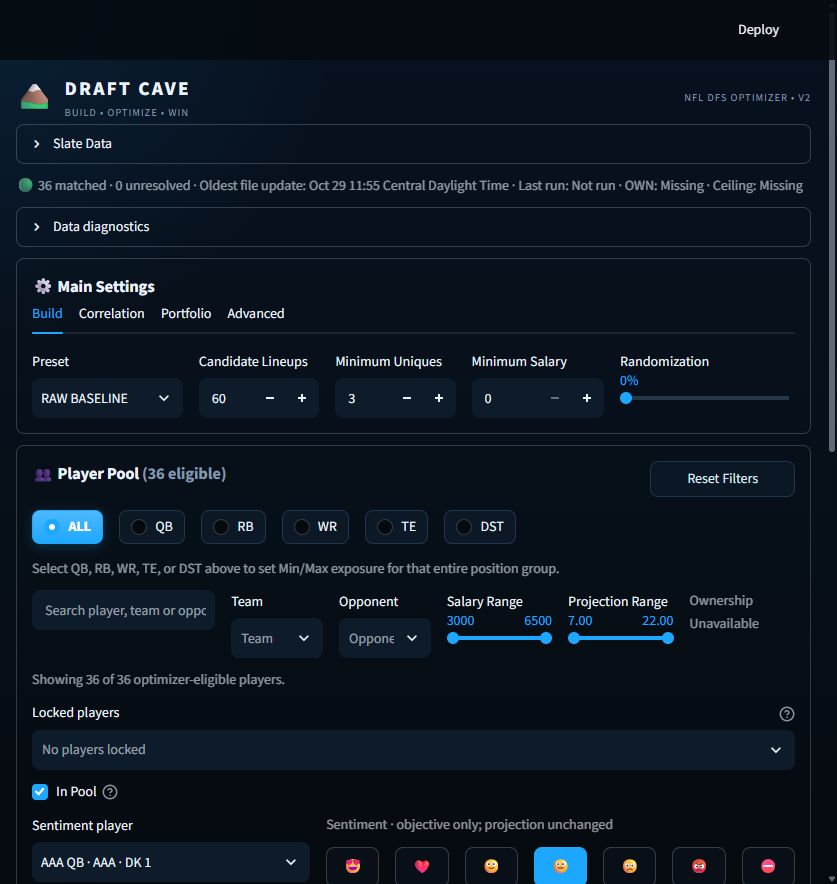
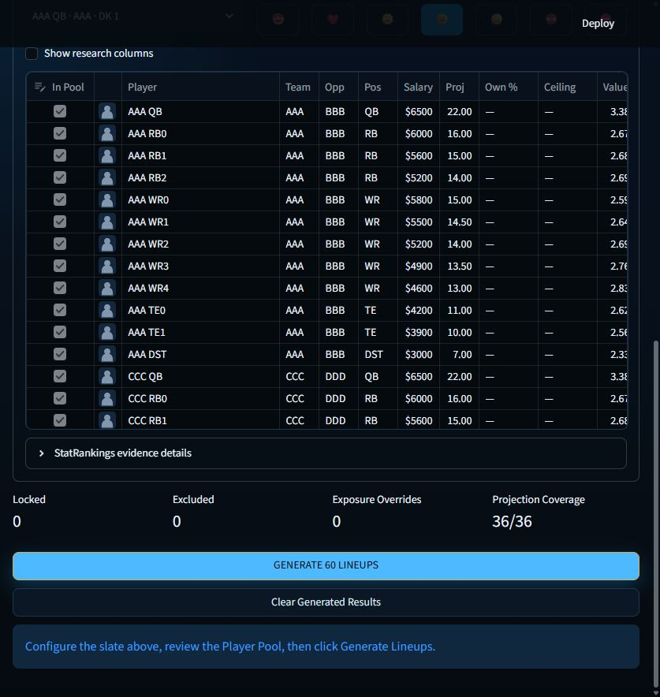

# Production UI V1 validation — 2026-10-29

- Local browser inspection completed for the main screen and compact Player Pool at 1280 × 720. Screenshots use synthetic AAA–FFF players, not a current NFL slate.
- Optimizer, configuration defaults, data loader, portfolio algorithms, exporter, API implementation, and last-run cache functions remain unchanged.
- CI dependencies are repaired and GitHub Actions is green on the latest player-identity regression test checkpoint.
- Player Pool identity guard is active at runtime through `app_css()`: the Player name is forced near the far left, receives a large column, and the standalone Visual column is suppressed in the default pool so images cannot squeeze names out.
- Default left-side scan target is now locked as `In Pool | Player | Pos | Team | Opp | ...`.
- Position-wide Min/Max behavior is explicitly regression-tested: selecting RB and applying Min/Max changes RBs only and leaves QB/WR/TE/DST values untouched. The same active-position-only contract applies to QB/WR/TE/DST.
- Individual player Min/Max overrides remain available after a position-wide bulk edit.
- Sentiment optimizer semantics remain exactly ADORE +10%, LOVE +7.5%, LIKE +5%, NEUTRAL 0%, DISLIKE -5%, HATE -10%, BAN exclude. Sentiment never mutates stored/displayed projection.
- Current implementation still uses a selected-player control plus visible sentiment buttons. The locked production target is now one current-state face per player, with the seven choices revealed only after interaction. This remains the primary visual-interaction item for the next runtime UI pass.
- BAN excludes; changing away from BAN does not silently re-add a player. Locks remain independent.
- Local asset resolution remains exact DK-ID headshot → exact team logo → placeholder. No fuzzy identity and no external image lookup.
- Missing ownership and ceiling remain `—`, never zero.
- Results remain organized as `Lineups | Exposure | Stacks & Games | Portfolio Risk | Repetition | Export`.
- No merge to `main`.

## Remaining V1 visual blockers

1. Replace the current sentiment selection surface with the one-face-first interaction and visually verify it.
2. Reintroduce headshot/team-logo presentation only if it can live inside/adjacent to Player identity without reducing name readability.
3. Run final desktop visual QA after those changes.
4. Only then consider merging/publishing.

## Current completion estimate

- Structural UI wiring: complete.
- Player-name visibility regression: fixed and regression-tested.
- Position-only bulk Min/Max: locked and regression-tested.
- Results navigation: wired.
- CI/test hardening: green.
- Remaining work is primarily final interaction polish and visual QA rather than optimizer functionality.

## Latest chat-side checkpoint

Completed without using Work:

- player-name visibility patch,
- regression protection for Player-left identity ordering,
- active-position-only bulk Min/Max regression test,
- exact DS-style interaction contract for exposure and sentiment,
- validation checkpoint updated for the next runtime pass.

The next Work/runtime session should not revisit architecture or optimizer behavior. It should focus only on the one-face sentiment interaction, optional identity visual reintegration, final visual QA, and publication readiness.

